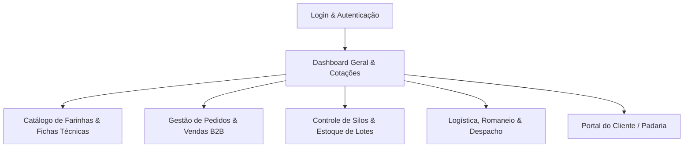

# TotalTrigo - Especificação de Requisitos e Arquitetura de Telas

## 1. Visão Geral do Projeto
O **TotalTrigo** é uma plataforma especializada na cadeia de valor e distribuição de trigo, farinhas especiais e insumos de panificação e moagem. A plataforma atende produtores, moinhos, distribuidoras e clientes finais (padarias artesanais, confeitarias e indústrias alimentícias), provendo controle ponta a ponta desde a recepção de grãos até a entrega fracionada ou a granel.

---

## 2. Elicitação de Requisitos (Task: DQ96roBfIXqI45t1aN9I)

### 2.1. Requisitos Funcionais (RF)
- **[RF01] Gestão de Catálogo e Especificações Técnicas de Farinha:**
  - Cadastro de tipos de farinha (T55, T65, Integral, Especial para Pães de Fermentação Natural, etc.).
  - Registro de índices reológicos fundamentais para panificação: Força do Glúten ($W$), Relação $P/L$, Teor de Cinzas, Teor de Proteína e Umidade máxima permitida.
- **[RF02] Controle de Silos, Lotes e Rastreabilidade:**
  - Mapeamento de silos físicos com capacidade volumétrica e leitura de sensores (temperatura e umidade).
  - Rastreabilidade bidirecional do lote: do grão moído ao pacote de farinha entregue ao cliente.
- **[RF03] Cotação Dinâmica e Preço de Commodities:**
  - Acompanhamento da cotação do trigo nacional e importado (CBOT / Bolsa de Chicago / CEPEA).
  - Tabela de preços escalonada por volume e prazos de pagamento para padarias e indústrias.
- **[RF04] Gestão de Pedidos B2B e Faturamento:**
  - Recepção de pedidos multicanal (Portal Web, Representantes Comerciais e WhatsApp).
  - Verificação automática de limite de crédito e integração com nota fiscal eletrônica (NF-e).
- **[RF05] Logística de Cargas e Romaneio:**
  - Planejamento de rotas de entrega por região metropolitana e interior.
  - Controle de pesagem na balança rodoviária na entrada e saída dos veículos.
- **[RF06] Portal de Autoatendimento da Padaria:**
  - Recompra rápida de insumos habituais com base no consumo médio semanal da panificadora.
  - Consulta de laudos técnicos de controle de qualidade de cada lote entregue.

### 2.2. Requisitos Não Funcionais (RNF)
- **[RNF01] Disponibilidade & Confiabilidade:** 99.8% de uptime, com redundância de dados em nuvem.
- **[RNF02] Performance:** Tempo de resposta inferior a 500ms para consultas de pedidos e estoque.
- **[RNF03] Usabilidade Mobile-first para Expedição:** Telas otimizadas para coletores e tablets no chão de fábrica e armazém.
- **[RNF04] Segurança e Auditoria:** Trilha de auditoria (audit trail) para todas as movimentações de estoque e precificação.

---

## 3. Arquitetura e Levantamento de Telas (Task: TraGNsB76BxXoeSpYuyJ)

### Mapa Estrutural de Telas

### Detalhamento das Telas:
1. **Tela 01 - Dashboard Executivo & Operacional:**
   - KPIs de volume expedido no dia (toneladas).
   - Ocupação percentual dos silos de armazenagem.
   - Indicador de preços em tempo real da saca de trigo.
   - Gráfico de pedidos pendentes por status de entrega.
2. **Tela 02 - Catálogo & Fichas Técnicas:**
   - Grid de produtos com badges visuais para tipos de moagem e força ($W$).
   - Download imediato de laudos de qualidade em PDF para cada lote.
3. **Tela 03 - Pedidos B2B & Checkout Comercial:**
   - Tabela densa com filtros por cliente, região e status de faturamento.
   - Modal com cálculo automático de peso bruto, tara e frete.
4. **Tela 04 - Gestão de Silos e Lotes:**
   - Visualização gráfica dos silos cilíndricos com nível de preenchimento em gradiente.
   - Alertas preventivos de temperatura crítica ou risco de pragas.
5. **Tela 05 - Expedição & Romaneio:**
   - Fila de pesagem de caminhões com integração de balança.
   - Checklist de liberação de carga e assinatura digital do motorista.
6. **Tela 06 - Portal da Padaria (B2B Self-Service):**
   - Histórico de pedidos anteriores com botão "Repetir Pedido".
   - Rastreamento em tempo real do caminhão em rota de entrega.
